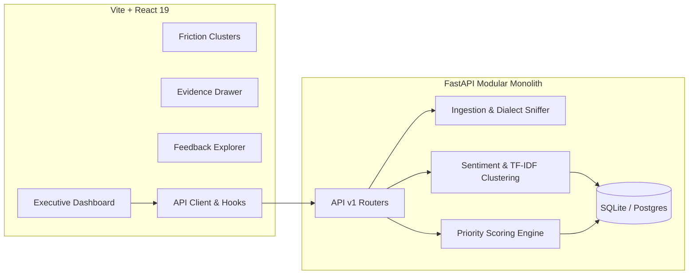

# InsightFlow — Intelligent Customer Feedback & Decision Platform

[](https://fastapi.tiangolo.com)
[](https://react.dev)
[](https://vitejs.dev)
[](https://python.org)
[](https://pytest.org)
[](LICENSE)

**InsightFlow** transforms raw, unstructured customer feedback into evidence-backed, prioritized engineering actions. Built for executive decision-makers and engineering leads who need traceable citations, deduplicated clustering, and explainable priority scoring rather than black-box summaries.

---

## Key Differentiators

- **Evidence-First Decision Intelligence**: Every friction cluster and recommendation cites verbatim customer quotes with rank-ordered centroid representatives and deduplication occurrence counts.
- **Explainable Priority Formula**: Prioritizes issues with a deterministic mathematical scoring engine (`Impact`, `Urgency`, `Trend`, `Evidence Density`, `Recency`). Safely rebalances weights when temporal or financial metadata is absent.
- **Honest Data Handling**: Ingests high-duplication customer review dumps (such as the 95.4% duplicate BuildBattle dataset) and honestly presents distinct counts rather than fabricating fake revenue or timestamps.
- **Provider-Agnostic AI Pipeline**:
  - **Sentiment**: VADER rule-based polarity indexing.
  - **Clustering**: Scikit-Learn TF-IDF n-grams + Agglomerative Cosine clustering.
  - **Recommendations**: Evidence-grounded deterministic generator with optional LLM augmentation.
  - **Adaptive Data**: Adaption Labs adapter architecture (`client.datasets.adapt`).

---

## System Architecture



---

## Repository Structure

```
├── backend/
│   ├── app/
│   │   ├── api/v1/         # REST API endpoints (datasets, issues, feedback, analytics)
│   │   ├── core/           # Config, database connection, errors, logging
│   │   ├── models/         # SQLAlchemy ORM entity models
│   │   ├── schemas/        # Pydantic v2 validation schemas
│   │   ├── services/       # Ingestion, sentiment, priority engine, clustering
│   │   └── main.py         # FastAPI app factory with CORS & health checks
│   ├── tests/              # 12 automated unit & integration tests (pytest)
│   ├── requirements.txt    # Python dependencies
│   └── seed.py             # Database seeding & analysis pipeline
├── data/                   # Bundled customer feedback dataset
├── docs/                   # Full backend & frontend architecture specifications
│   ├── backend-architecture.md
│   ├── api-contract.md
│   ├── frontend-architecture.md
│   └── implementation-plan.md
├── src/
│   ├── api/                # Scalable API client with endpoints & error envelopes
│   ├── components/         # Modular UI, canvas shaders, navigation & feature cards
│   ├── config/             # Environment configs & constants
│   ├── context/            # React WorkspaceContext state manager
│   ├── hooks/              # Custom data hooks (useIssues, useFeedback, useAnalytics)
│   └── main.jsx            # Application mount with ErrorBoundary
├── index.html              # Executive Workspace HTML template
├── package.json            # Node.js scripts and dependencies
└── vite.config.js          # Vite config with API reverse proxy
```

---

## Quickstart Guide

### 1. Prerequisites
- **Node.js**: 18.0+
- **Python**: 3.12+ (tested on Python 3.13)

### 2. Setup Backend & Python Environment

```bash
# Create virtual environment
python -m venv venv

# Activate virtual environment
# On Windows:
.\venv\Scripts\activate
# On macOS/Linux:
source venv/bin/activate

# Install dependencies
pip install -r backend/requirements.txt
```

### 3. Seed Database & Run Analysis

Populate SQLite with the 7,000-row customer dataset and execute the 10-stage AI clustering pipeline:

```bash
python backend/seed.py
```

### 4. Setup Frontend

```bash
npm install
```

### 5. Run Development Servers

Start both servers:

```bash
# Terminal 1: Backend API (FastAPI on port 8000)
npm run server

# Terminal 2: Frontend (Vite on port 5173 with proxy)
npm run dev
```

- **Frontend Dashboard**: [http://localhost:5173](http://localhost:5173)
- **Backend API**: [http://127.0.0.1:8000](http://127.0.0.1:8000)
- **Interactive API Docs (Swagger UI)**: [http://127.0.0.1:8000/docs](http://127.0.0.1:8000/docs)

---

## Automated Test Suite

Run the complete test suite covering ingestion, sentiment analysis, priority calculations, and API contracts:

```bash
npm run test:backend
# or: pytest -v
```

---

## API Summary

| Method | Endpoint | Description |
| :--- | :--- | :--- |
| `GET` | `/health` | Liveness health check |
| `GET` | `/ready` | Readiness check (database & pipeline operational) |
| `GET` | `/api/v1/datasets` | List imported datasets with distinct text metrics |
| `POST` | `/api/v1/datasets/imports` | Multipart CSV stream ingestion with dialect sniffing |
| `GET` | `/api/v1/issues` | Friction clusters ordered by priority score |
| `GET` | `/api/v1/issues/{id}` | Issue detail with verbatim customer citations |
| `PATCH` | `/api/v1/issues/{id}` | State transitions (`open` → `investigating` → `planned` → `resolved`) |
| `GET` | `/api/v1/feedback` | Paginated customer quotes with search and sentiment filtering |
| `GET` | `/api/v1/datasets/{id}/analytics` | Aggregated KPIs, sentiment distribution, and honest data notices |
| `GET` | `/api/v1/reports/{id}/export.csv` | Download evidence-grounded priority report in CSV format |
| `GET` | `/api/v1/integrations/status` | Real-time status of configured AI providers & adapters |

---

## License

MIT © [mstanmay](https://github.com/mstanmay)
