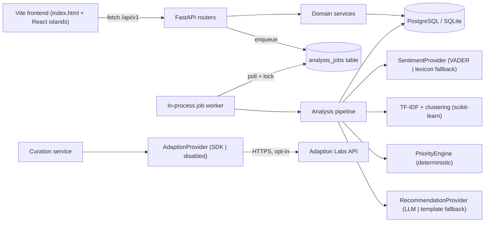
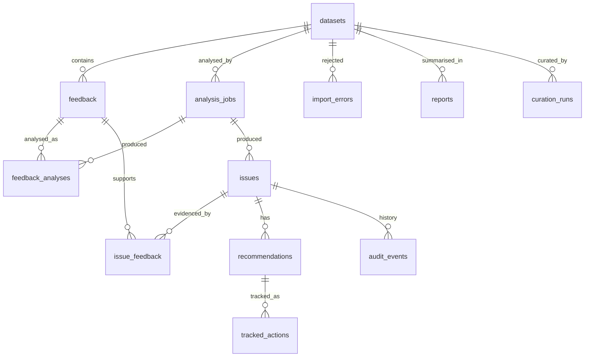

# InsightFlow — Backend Architecture

Status: **Proposed (Phase 1)** · Last audited: 2026-10-11

---

## 1. Repository audit (facts, not assumptions)

| Area | Finding | Consequence |
|---|---|---|
| Frontend framework | **Vite 6 + static `index.html` + Tailwind CDN**, with React 19 "islands" mounted into DOM nodes (`src/main.jsx`). **Not Next.js.** | Integration is via a small `fetch` client in `src/api/`, not Next.js routes/server actions. |
| Frontend data | 100% hardcoded mocks in `src/main.jsx` (`feedbackRecords`, `issueContexts`, `trajectoryData`) and inline HTML in `index.html`. No `fetch`, no env vars. | Every view must be rewired. Several mock metrics cannot be produced from the real data (see §2). |
| Views | `overview`, `studio` (Decision Studio / ROI calc), `radar` (Friction Radar), `explorer` (Feedback table), `terminal` (Telemetry Stream), drawers/modals: evidence drawer, CSV import modal, hotfix modal. | API contract maps to these views (see `api-contract.md`). |
| Backend | **None exists.** | Greenfield `backend/` directory in the same repo. |
| Legacy/dupes | `src/main.js` duplicates `src/main.jsx`; `src/components/core/ToolbarDynamic.jsx` duplicates `src/ToolbarDynamic.jsx`. | Flag for cleanup; not touched by backend work. |
| Toolchain | Python **3.13.15** ✅, `fastapi` + `sqlalchemy` already installed; `pandas`, `scikit-learn` missing. **Docker not installed. Not a git repo.** | Use a `venv`; SQLite for local dev; Dockerfile written but cannot be built locally; `git init` required before CI. |
| Problem statement | `Downloads/Problem_Statement.pdf` (Build Battle 2026). Requires: submit + CSV import + sample data; sentiment, topics, grouping; **meaningful Adaption use**; dashboard + trends + filters; prioritized, explained recommendations; issue tracking; exportable report; live deployment. | Drives scope. |

## 2. Real dataset profile — `BuildBattle_2026_Customer_Feedback_Dataset.csv`

| Property | Value |
|---|---|
| Size | 660 KB, UTF-8, no BOM |
| Columns | **`review`, `category`** (only two) |
| Rows | **7,000** (all well-formed, 2 fields) |
| Distinct `review` texts | **320** |
| Exact duplicate rows | **6,680 (95.4%)** |
| Missing values | none |
| `category` labels | `Operational Issues` 1,800 · `Fraud and Scam` 1,755 · `Product Feedback` 1,738 · `Customer Service` 1,707 |
| Dates / source / rating / product / language / id | **Absent** |

### Hard consequences (the backend must be honest about these)

1. **No timestamps → Trend and Recency cannot be computed for this dataset.** They are returned as `null` with `availability: "unavailable"` and a reason. We will **not** fabricate dates, and import time is **not** used as a proxy for when feedback was written.
2. **95% duplication → raw row volume is not evidence strength.** Duplicates are preserved (never discarded) but grouped by content hash; evidence strength is driven by *distinct* texts, with row counts reported separately.
3. **No revenue/order/NPS/rating fields → the frontend's GMV ($42.5K), NPS (+38), order values, ROI ($1.84M), Jira keys, "96.4% confidence" and "P99 22ms" have no data source.** They must be replaced by backend metrics or explicitly marked "not available in this dataset" (decision required — see implementation plan).
4. **`category` is a provided label, not model output.** It is stored as `source_category` and used for filtering and as weak supervision; our own topic clusters are stored separately.
5. Mapping: `review → text`, `category → category`. `id` is generated (UUID) plus a stable `external_ref = "row-{n}"` for traceability to the source file.

## 3. Architectural style

A **modular monolith** (FastAPI) with a **database-backed job table** and an **in-process worker thread**. No Redis/Kafka/vector DB: the largest realistic input (7k rows / 320 distinct texts) analyses in seconds on CPU.



## 4. Backend layout

```
backend/
  app/
    main.py                  # app factory, CORS, error handlers, router mount, worker start
    core/                    # config.py (pydantic-settings), db.py, logging.py, errors.py, ids.py
    models/                  # SQLAlchemy 2.x ORM models (one file per aggregate)
    schemas/                 # Pydantic v2 request/response models + error envelope + pagination
    api/v1/                  # health, datasets, imports, jobs, feedback, analysis, issues,
                             # recommendations, reports, integrations
    services/
      ingestion/             # csv_reader, column_mapper, validator, normalizer, dedup, importer
      analysis/              # pipeline (stage runner), sentiment, keywords, clustering,
                             # issue_builder, trends, evidence
      priority.py            # explainable scoring engine (pure functions)
      recommendations.py     # prompt builder, output validation, evidence-ID check, fallback
      issues.py              # state machine + audit trail
      analytics.py           # chart-ready aggregates
      reports.py, export.py  # JSON report + CSV export (formula-injection safe)
      curation.py            # Adaption-backed training-data curation workflow
    providers/
      sentiment/  base.py, vader.py, lexicon.py
      llm/        base.py, <verified provider>.py, template.py
      adaption/   base.py, sdk.py, disabled.py
    worker/runner.py         # job polling, locking, stage status updates
  alembic/                   # migrations
  tests/  unit/ api/ e2e/ fixtures/
  pyproject.toml  Dockerfile  .env.example
```

Frontend changes are limited to a new `src/api/client.js` + per-view adapters; layout and design are preserved.

## 5. Ingestion pipeline

1. **Receive** multipart upload. Reject if > `MAX_UPLOAD_MB`.
2. **Sniff content**, not extension: decode UTF-8 (fallback `utf-8-sig`, then `cp1252` with a warning), `csv.Sniffer` for dialect, reject binary/NUL bytes.
3. **Header mapping**: case/space-insensitive alias table (`review|text|feedback|comment|body → text`; `category|topic|label → category`; `date|created_at|timestamp → created_at`; etc.). Unmapped columns go to `feedback.extra` JSON. A client may pass an explicit `column_mapping` override.
4. **Preview mode** (`?dry_run=true`): returns mapping, first 20 normalized rows, row-level errors; persists nothing.
5. **Row validation**: missing/blank text, text > 5,000 chars, unparseable dates (kept, `created_at = null`, warning), rating out of range.
6. **Normalization**: Unicode NFKC, whitespace collapse, control-char strip → `normalized_text`. `original_text` is kept verbatim.
7. **Dedup strategy (documented)**:
   - *File-level idempotency*: SHA-256 of file bytes; re-uploading the same file returns the existing dataset unless `force=true`.
   - *Row-level*: `content_hash = sha256(casefold(normalized_text))`. All rows are persisted; the first occurrence is canonical, later ones get `duplicate_of_id`. Analysis runs once per distinct hash and fans out.
8. **Persist** valid rows in one transaction per batch (1,000 rows); rejected rows go to `import_errors` with row number + reason; downloadable as CSV.
9. **Create** a queued `analysis_job` and return the import summary.

## 6. Analysis pipeline

Each stage writes `stage`, `status`, counts and timing to the job; per-record failures are recorded, not fatal.

| # | Stage | Implementation | Recorded identifier |
|---|---|---|---|
| 1 | Normalize | Done at ingest; re-verified | `normalizer@1` |
| 2 | Language | `langdetect`-style check **only if** cheap and useful; otherwise `language = null` | `lang:none` or lib@version |
| 3 | Sentiment | **VADER** (lexicon + rules, MIT). Fallback: small built-in lexicon. Both labelled as *lexicon-based*, never "AI model". Optional LLM sentiment only if explicitly enabled. | `vader@3.3.2` / `lexicon-fallback@1` |
| 4 | Keywords | TF-IDF (1–2 grams, English stopwords) over distinct texts | `tfidf@sklearn-x.y` |
| 5 | Grouping | TF-IDF vectors → Agglomerative clustering (cosine, distance threshold) per `source_category`; cluster label from top terms | `agglo-cosine@1` |
| 6 | Issue aggregation | Clusters whose sentiment is predominantly negative/neutral become **issues**; positive clusters become **strengths** (reported, not prioritized) | — |
| 7 | Trends | Only when ≥ 2 comparable windows with ≥ `MIN_TREND_SAMPLES` timestamped records; else `unavailable` | `window-compare@1` |
| 8 | Evidence | Up to 5 representatives: nearest-to-centroid **distinct** texts, diversity-filtered (cosine < 0.9 to each other) | `centroid-mmr@1` |
| 9 | Priority | Deterministic engine (§7) | `priority@1` + weights hash |
| 10 | Recommendations | LLM w/ validation or template fallback (§8) | provider + model id |
| 11 | Persist | `feedback_analyses`, `issues`, `issue_feedback`, `recommendations` in one transaction per stage | `pipeline_version` |

Reproducibility: `pipeline_version` + `config_hash` (weights, thresholds, provider ids) is stored on every job; same inputs + same config ⇒ same outputs (clustering uses fixed parameters, no random seeds needed for agglomerative).

## 7. Explainable priority engine

`Priority = 100 × Σ wᵢ·cᵢ / Σ wᵢ (over available components)` with default weights Impact .30, Urgency .25, Trend .20, EvidenceStrength .15, Recency .10.

| Component | Definition for this product | Honesty rule |
|---|---|---|
| Impact | `0.6 × mean negative intensity (VADER compound, negated, clipped 0–1)` + `0.4 × configured category severity weight` | Severity weights are **configuration, labelled `estimate`**, not data. |
| Urgency | share of evidence containing configured urgency markers (e.g. *scam, fraud, charged, crash, missing, wrong item, refund*) blended with intensity | Marker list is returned in the explanation. |
| Trend | `clip((recent − previous)/max(previous,1), −1, 1)` mapped to 0–1 | `null` if timestamps insufficient. |
| EvidenceStrength | `(1 − e^(−distinct/8)) × sentiment_consistency`; capped at 0.3 if `distinct < 5` | Uses **distinct** texts; duplicates do not inflate it. |
| Recency | `e^(−days_since_last/30)` | `null` without timestamps. |

- Unavailable components are **excluded and weights renormalized**; the response lists them and **confidence drops one level per missing temporal component** (`high → medium → low`).
- Output: `score`, `components[] {name, value, weight, effective_weight, available, explanation}`, `confidence`, `label: "decision-support score (not a probability of churn or loss)"`.
- Pure functions, fully unit-tested (normal, missing data, sparse, boundaries 0/1, all-unavailable ⇒ score `null`).

## 8. Recommendation engine

- **Input to LLM** (structured JSON): issue metadata, backend-computed stats, ≤ 5 evidence records `{feedback_id, text}`, score breakdown, limitations. Feedback is wrapped in a delimited `untrusted_customer_text` block with an instruction that it is data, not instructions.
- **Output** validated by Pydantic: `title, problem_statement, recommended_action, rationale, supporting_feedback_ids, expected_outcome, confidence_label, limitations`.
- **Post-validation**: every `supporting_feedback_id` ∈ provided evidence set; numbers in text are not trusted — counts shown in UI always come from the DB. Violations ⇒ one retry, then fallback.
- Timeouts (20 s), 2 bounded retries, cache keyed by `(issue_id, evidence hash, prompt version, model)`.
- **Template fallback** (no external call) builds the same schema from issue data; labelled `generated_by: "template"`.
- All LLM output stored with `generated_by: "llm"`, `model`, `prompt_version`, and shown as **AI-generated** in the UI.
- **No external call happens unless `AI_PROVIDER` and a key are explicitly configured.**

## 9. Adaption integration (verified)

**Verified identity:** Adaption = **Adaption Labs** (`docs.adaptionlabs.ai`), Python SDK `pip install adaption`, auth via `ADAPTION_API_KEY` (read automatically by `Adaption()`). Product **Adaptive Data** imports a dataset (CSV/JSON/JSONL/Parquet), maps columns to `prompt` / `completion` / `context`, applies recipes (dedup, rephrase, reasoning traces), optionally augments/translates, runs **asynchronously**, consumes **credits**, supports an `estimate=True` quote, exposes `get_status`, `wait_for_completion`, `get_evaluation`, and `download(file_format=...)`. There is also AutoScientist (model training).

**What Adaption is *not*:** a real-time sentiment/classification API. Using it per-request would be both wrong and slow.

**Meaningful, honest role in InsightFlow — "Feedback Training-Data Curation":**

1. InsightFlow exports the deduplicated, labelled corpus as an instruction dataset: `prompt = review text`, `completion = category` (provided labels) — 320 distinct examples for the supplied file.
2. `AdaptionProvider.upload_dataset()` → `adapt(estimate=True)` (credit quote shown in UI) → `adapt()` → poll status → `get_evaluation()` → `download(csv)`.
3. The adapted/augmented dataset trains InsightFlow's local **category classifier** (TF-IDF + Logistic Regression), which classifies newly submitted feedback that arrives without a category.
4. Each classifier version records `training_data_provider: "adaption" | "local"`, Adaption `dataset_id`/`run_id`, and evaluation metrics, so the demo can show baseline vs Adaption-curated accuracy on a held-out split.

Interface: `AdaptionProvider` (`status()`, `upload_dataset()`, `estimate()`, `start_adaptation()`, `get_status()`, `get_evaluation()`, `download()`), implementations `AdaptionSdkProvider` and `DisabledAdaptionProvider`. `GET /integrations/status` reports `disabled | configured | reachable | error` from a **real** lightweight call (e.g. `datasets.list(limit=1)`), never a hardcoded "connected".

Open items (verified during Phase 7 against the API reference, not guessed): exact `adapt()` recipe parameters, augmentation parameters, evaluation schema, credit costs, rate limits. Requires an **API key from the user/organiser**.

## 10. Data model



Key columns (full dictionary in `docs/data-dictionary.md`, Phase 9):

- `datasets`: id, name, source_filename, file_sha256 (unique), row_count, valid_count, rejected_count, distinct_text_count, column_mapping JSON, status, created_at.
- `feedback`: id, dataset_id, external_ref, original_text, normalized_text, content_hash, duplicate_of_id, created_at (nullable — *observed* time), received_at, source, rating, source_category, product, language, extra JSON. Indexes: (dataset_id), (content_hash), (created_at), (source_category).
- `analysis_jobs`: id, dataset_id, status, stage, processed/failed counts, provider_ids JSON, pipeline_version, config_hash, error_category, started_at, completed_at, idempotency_key (unique).
- `feedback_analyses`: id, feedback_id (canonical rows only), job_id, sentiment_label, sentiment_score, sentiment_provider, keywords JSON, cluster_key, predicted_category, created_at. Unique (feedback_id, job_id). Index (sentiment_label).
- `issues`: id, dataset_id, job_id, title, topic, description, kind (`issue|strength`), row_count, distinct_count, sentiment_distribution JSON, first_seen, last_seen, trend JSON, priority_score, priority_breakdown JSON, confidence, status, owner, created_at. Index (status), (dataset_id, priority_score).
- `issue_feedback`: issue_id, feedback_id, is_representative, rank.
- `recommendations`: id, issue_id, payload JSON (validated schema), generated_by, model, prompt_version, status (`proposed|accepted|dismissed|tracking`), created_at.
- `tracked_actions`, `audit_events` (entity, entity_id, action, from, to, actor, note, at), `reports` (filters JSON, snapshot JSON), `import_errors`, `curation_runs` (Adaption ids, status, credits_estimate, metrics JSON).

IDs: UUIDv4 strings. Human-friendly issue keys (`ISS-001`) generated per dataset for display.

Deletion: `DELETE /datasets/{id}` cascades to all derived rows (documented retention: data lives until the dataset is deleted; no background retention job in MVP).

## 11. Job lifecycle & idempotency

`queued → running → completed | completed_with_errors | failed`. The worker claims a job with an atomic `UPDATE … WHERE status='queued'` (works on SQLite and Postgres). `POST /datasets/{id}/analyze` returns the existing active/completed job for the same `(dataset_id, config_hash, pipeline_version)` unless `force=true`. Stuck `running` jobs older than a timeout are marked `failed` on startup.

## 12. Security & privacy (MVP)

- **No authentication / no multi-tenancy in the MVP** — stated in README and API docs; not suitable for real customer PII as-is.
- Pydantic validation on all inputs; ORM-parameterized queries; upload size + row caps; content sniffing.
- CORS restricted to `FRONTEND_ORIGINS`. Simple in-memory per-IP rate limit on upload/analyze/LLM endpoints.
- Logs never include feedback text or secrets (structured JSON logs with request_id, job_id).
- CSV export escapes cells starting with `= + - @ \t \r`.
- External transfer (LLM, Adaption) is **off by default** and requires explicit env configuration; documented per provider.
- Error envelope never contains stack traces.

## 13. Configuration

`APP_ENV, API_V1_PREFIX, DATABASE_URL, FRONTEND_ORIGINS, MAX_UPLOAD_MB, MAX_CSV_ROWS, LOG_LEVEL, AI_PROVIDER, AI_API_KEY, AI_MODEL, ADAPTION_ENABLED, ADAPTION_API_KEY, PRIORITY_WEIGHTS (JSON), CATEGORY_SEVERITY (JSON)`. `ADAPTION_API_KEY` matches the official SDK's env var. Startup fails fast in `APP_ENV=production` if `DATABASE_URL` is SQLite or CORS is `*`.

## 14. Assumptions & unknowns

| # | Item | Status |
|---|---|---|
| U1 | LLM provider for recommendations | **Needs decision** (template fallback works without it) |
| U2 | Adaption API key + credit budget | **Needs user/organiser** |
| U3 | Handling of unsupported frontend metrics (GMV, NPS, ROI, order value) | **Needs decision** |
| U4 | Deployment target (Render / Railway / Fly / other) | Needs decision before Phase 9 |
| U5 | Whether the frontend should move to `frontend/` | Recommended **no** (avoid breaking working build) |
| A1 | English-only feedback for the supplied dataset | Assumed; language stage is best-effort |
