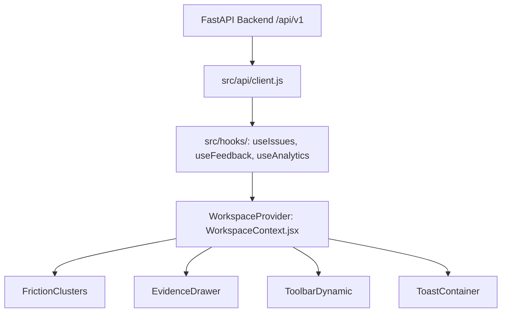

# InsightFlow — Frontend Architecture & Codebase Guide

## 1. Directory Structure

```
src/
├── api/                      # Scalable API Gateway
│   ├── client.js             # Core HTTP client with ApiError & interceptors
│   ├── index.js              # Central gateway export
│   └── endpoints/            # Modular endpoint definitions
│       ├── datasets.js       # Dataset upload, retrieval & deletion
│       ├── issues.js         # Friction cluster listing, detail, state transitions
│       ├── feedback.js       # Customer feedback records, search & pagination
│       └── analytics.js      # Aggregates, job telemetry, and report export URLs
├── components/               # Modular UI Components
│   ├── canvas/               # Three.js / WebGL background effects
│   │   ├── FloatingLines.jsx # WebGL animated wave shader
│   │   ├── FloatingLines.css # Container styles
│   │   ├── GlobalBackground.jsx # Theme-reactive background mount
│   │   └── index.js          # Barrel export
│   ├── core/                 # Low-level primitives
│   │   └── text-effect.jsx   # Motion-primitives text animation
│   ├── features/             # Business feature components
│   │   ├── FrictionClusters.jsx # Prioritized cluster cards with BorderGlow
│   │   └── index.js          # Barrel export
│   ├── navigation/           # App navigation & interaction
│   │   ├── ToolbarDynamic.jsx # Floating quick-search & theme toggle
│   │   ├── TextEffectPerChar.jsx # Hero typography animator
│   │   └── index.js          # Barrel export
│   └── ui/                   # Reusable Design System components
│       ├── BorderGlow.jsx    # Mouse-following proximity border illumination
│       ├── BorderGlow.css    # High-performance CSS conic masks
│       ├── ToastContainer.jsx # Reactive notifications queue
│       ├── ErrorBoundary.jsx # React rendering failure fallback
│       └── index.js          # Barrel export
├── config/                   # Centralized Configuration
│   └── index.js              # Environment variables, constants & view names
├── context/                  # State Management
│   └── WorkspaceContext.jsx  # Central workspace provider (theme, views, dataset, drawer, toasts)
├── hooks/                    # Reusable Custom React Hooks
│   ├── useAnalytics.js       # Fetches aggregated dataset KPIs
│   ├── useClickOutside.js    # Modal/dropdown outside-click detection
│   ├── useFeedback.js        # Feedback search, filtering & debounced pagination
│   ├── useIssues.js          # Friction issues querying & refresh
│   └── index.js              # Barrel export
├── lib/                      # Helper utilities
│   └── utils.js              # Common string/CSS utilities
├── style.css                 # Global styling, fonts & obsidian design tokens
└── main.jsx                  # Main application bootstrapper & React mount
```

---

## 2. Separation of Concerns

- **Business Logic**: Encapsulated in `src/hooks/` (`useIssues`, `useFeedback`, `useAnalytics`) and `src/api/`. UI components never perform raw `fetch()` calls directly.
- **UI Components**: Presentational components in `src/components/` receive data and callbacks via props or context hooks (`useWorkspace()`).
- **State Management**: Handled centrally via `WorkspaceProvider` (`src/context/WorkspaceContext.jsx`), avoiding prop-drilling.

---

## 3. Scalable API Layer

All API operations flow through the standardized `request()` helper in `src/api/client.js`:

```javascript
import { api, ApiError } from '@/api';

try {
  const issues = await api.getIssues({ dataset_id: activeId, pageSize: 10 });
} catch (err) {
  if (err instanceof ApiError) {
    console.error(`API Error [${err.code}]:`, err.status, err.message);
  }
}
```

### Endpoints Map
- `api.getDatasets(page, pageSize)`: List imported CSV datasets.
- `api.uploadDataset(file, name)`: Stream CSV file with automatic column dialect sniffing.
- `api.getIssues(params)`: Query clustered friction issues sorted by priority score.
- `api.getIssueDetail(issueId)`: Query centroid citations, recommendations, and evidence items.
- `api.getFeedback(params)`: Query feedback records with server-side text search and category filtering.
- `api.getAnalytics(datasetId)`: Query KPI totals, sentiment distribution, and data limitations.
- `api.getExportUrl(datasetId)`: Direct URL for CSV priority report download.

---

## 4. State Management Flow



### Context State Properties:
- `theme`: `'dark' | 'light'` (automatically persisted in `localStorage`).
- `activeView`: `'overview' | 'studio' | 'radar' | 'explorer' | 'terminal'`.
- `activeDataset`: Currently selected dataset record.
- `drawerOpen` / `activeIssueId`: Active drill-down drawer state.
- `toasts`: Reactive notification queue with automatic 4-second dismissal.

---

## 5. Consistent Naming Conventions

- **React Components**: PascalCase (`BorderGlow.jsx`, `FrictionClusters.jsx`, `ErrorBoundary.jsx`).
- **Hooks & Utilities**: camelCase (`useIssues.js`, `useFeedback.js`, `apiClient.js`).
- **Constants**: UPPER_SNAKE_CASE (`VIEWS.OVERVIEW`, `SENTIMENT_LABELS.CRITICAL`).
- **Barrel Files**: `index.js` in every component directory for clean relative imports:
  ```javascript
  import { BorderGlow, ErrorBoundary } from '@/components/ui';
  import { GlobalBackground } from '@/components/canvas';
  import { FrictionClusters } from '@/components/features';
  ```

---

## 6. Error Handling

1. **Rendering Level**: Protected with `<ErrorBoundary>` to avoid white screens upon component crash.
2. **Network Level**: `ApiError` distinguishes network failures, HTTP 4xx client errors, and HTTP 5xx server exceptions.
3. **User Level**: Reactive feedback through `ToastContainer` with visual severity distinctions (`success`, `info`, `warning`, `error`).
