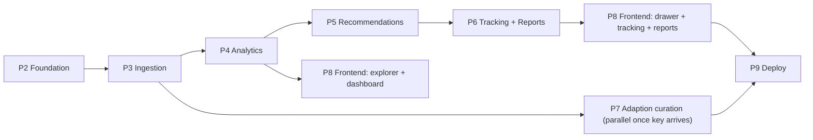

# InsightFlow — Backend Implementation Plan

Status: **Awaiting approval** · Companion docs: [backend-architecture.md](./backend-architecture.md), [api-contract.md](./api-contract.md)

Each phase ends with: tests run, results, changed files, endpoints added, remaining gaps. Effort estimates assume one developer inside the 48-hour window.

Legend: **P0** = required for a demonstrable submission · **P1** = strongly expected by judges · **P2** = polish if time remains.

---

## Phase 1 — Repository audit & architecture *(done in this step)*

| ID | Task | Output | Status |
|---|---|---|---|
| 1.1 | Inspect repo, frontend stack, views, mock data | Audit table in architecture §1 | ✅ |
| 1.2 | Profile real CSV (schema, duplicates, dates) | Architecture §2 | ✅ |
| 1.3 | Read problem statement PDF | Scope mapping | ✅ |
| 1.4 | Verify Adaption identity from official docs | Architecture §9 | ✅ (API key pending) |
| 1.5 | Write architecture, API contract, plan | `docs/*.md` | ✅ |

## Phase 2 — Backend foundation · P0 · ~3 h

| ID | Task | Acceptance criteria |
|---|---|---|
| 2.1 | `backend/` scaffold, `pyproject.toml`, venv, pinned deps (fastapi, uvicorn, pydantic-settings, sqlalchemy 2, alembic, pandas, scikit-learn, vaderSentiment, httpx, pytest, ruff) | `pip install -e .[dev]` succeeds on Python 3.13 |
| 2.2 | `core/config.py` (pydantic-settings) + `.env.example` | Prod-mode startup validation rejects SQLite / `*` CORS |
| 2.3 | `core/db.py` session mgmt; SQLite default, Postgres via `DATABASE_URL` | Both URLs connect in tests (Postgres optional/skipped if absent) |
| 2.4 | Structured JSON logging + request-id middleware (no feedback text in logs) | Log line contains request_id, path, status, ms |
| 2.5 | Error envelope + exception handlers | Unknown error returns `internal_error` without trace |
| 2.6 | CORS from `FRONTEND_ORIGINS`; simple per-IP rate limiter | Disallowed origin gets no CORS headers |
| 2.7 | All ORM models + initial Alembic migration | `alembic upgrade head` on empty SQLite succeeds; downgrade works |
| 2.8 | `GET /health`, `GET /ready` (DB + migration head + worker) | Tests pass |
| 2.9 | Ruff config, `pytest` config, `conftest.py` with temp DB | `ruff check` + `pytest` green |

## Phase 3 — Feedback management & CSV ingestion · P0 · ~5 h

| ID | Task | Acceptance criteria |
|---|---|---|
| 3.1 | CSV reader: size cap, encoding fallback, sniffing, NUL/binary rejection | Malformed/binary/empty files → 400 with code |
| 3.2 | Column mapper with alias table + explicit override; unmapped → `extra` | Real CSV maps `review→text`, `category→category` |
| 3.3 | Row validator + normalizer (NFKC, whitespace, length) keeping `original_text` | Row-level errors with row numbers |
| 3.4 | Dedup: file SHA-256 idempotency; row `content_hash` + `duplicate_of_id` | Real CSV → 7,000 rows stored, 320 canonical, 6,680 flagged |
| 3.5 | `POST /datasets/imports` incl. `dry_run`, `force`, batch transactions | Preview persists nothing; re-upload → 409 |
| 3.6 | `import_errors` table + `GET /imports/{id}/errors.csv` | Formula-escaped CSV |
| 3.7 | `GET /datasets`, `/datasets/{id}`, `DELETE`, `/imports/{id}` | Cascade delete verified |
| 3.8 | `POST /feedback`, `GET /feedback` (filters, search, sort, pagination), `GET /feedback/{id}` | `include_duplicates=false` returns 320 for real CSV |
| 3.9 | Seed command `python -m app.seed` loading the supplied CSV as sample data (problem statement requires sample data) | Idempotent |
| 3.10 | Tests: header mapping, empty, malformed, missing text, duplicates, invalid dates, oversized, pagination | Green |

## Phase 4 — Deterministic analytics · P0 · ~6 h

| ID | Task | Acceptance criteria |
|---|---|---|
| 4.1 | Job table service + in-process worker (atomic claim, stage updates, stuck-job recovery) | Job progresses queued→running→completed |
| 4.2 | Idempotent `POST /datasets/{id}/analyze` (config hash) | Second call returns same job |
| 4.3 | `SentimentProvider` interface; `VaderProvider`; `LexiconFallbackProvider` | Provider id persisted per analysis |
| 4.4 | Keyword extraction (TF-IDF) on distinct texts | Top terms per record stored |
| 4.5 | Clustering (agglomerative cosine, per category) + label generation | Stable output across runs |
| 4.6 | Issue builder: issue vs strength, counts (rows & distinct), sentiment distribution | Issues link to real feedback ids |
| 4.7 | Trend service with minimum-sample rule; `unavailable` metadata | Real CSV → unavailable with reason |
| 4.8 | Evidence selector (centroid + diversity, distinct texts only) | ≤5 representatives, no duplicates |
| 4.9 | **Priority engine** (pure functions, configurable weights, renormalization, confidence downgrade, sparse cap) | Unit tests: normal, missing temporal, sparse, boundaries, all-unavailable |
| 4.10 | `GET /datasets/{id}/analytics`, `/trends`, `/issues`, `/jobs/{id}` | Chart-ready shapes per contract |
| 4.11 | Tests: sentiment aggregation, grouping, evidence, priority, missing temporal data | Green |

## Phase 5 — Evidence-first recommendations · P0 (template) / P1 (LLM) · ~4 h

| ID | Task | Acceptance criteria |
|---|---|---|
| 5.1 | Recommendation Pydantic schema + `RecommendationProvider` interface | — |
| 5.2 | Template provider (no network) generating the full schema from issue data | Always available; `generated_by:"template"` |
| 5.3 | LLM provider (chosen in Decision D1) with prompt-injection-safe prompt, timeout, bounded retries, cache | Disabled unless key set |
| 5.4 | Validation: schema + evidence-ID membership; fallback on violation | Test with fabricated id → rejected → fallback |
| 5.5 | `GET /issues/{id}/recommendations` (+ `regenerate`) | — |
| 5.6 | Tests with mocked LLM: valid, malformed JSON, foreign ids, timeout | Green, no paid API needed |

## Phase 6 — Issue tracking & reports · P0 · ~4 h

| ID | Task | Acceptance criteria |
|---|---|---|
| 6.1 | Issue state machine + `PATCH /issues/{id}` + audit events | Invalid transition → 409 |
| 6.2 | `POST /recommendations/{id}/actions` (accept/dismiss/track) + `tracked_actions` | Audit trail recorded |
| 6.3 | `GET /issues`, `/issues/{id}` with evidence, breakdown, audit | — |
| 6.4 | Report snapshot builder (findings, issues, evidence refs, recs, methodology, limitations) | Reflects filters; immutable |
| 6.5 | `POST/GET /reports`, `GET /reports/{id}`, `export.csv` with formula escaping | Escaping test for `=`, `+`, `-`, `@` |
| 6.6 | **E2E test**: import → analyze → analyses → issues → recommendation → status change → report export (synthetic fixture) | Green |

## Phase 7 — Adaption integration · P0 (required by organisers) · ~4 h + Adaption run time

| ID | Task | Acceptance criteria |
|---|---|---|
| 7.1 | Install `adaption` SDK; read API reference for `create/upload_file`, `adapt`, `get_status`, `get_evaluation`, `download` | Exact signatures recorded in `docs/adaption-integration.md` |
| 7.2 | `AdaptionProvider` interface + `DisabledAdaptionProvider` + `AdaptionSdkProvider` (timeouts, error mapping) | No fake methods |
| 7.3 | Real `GET /integrations/status` check | Shows `disabled` without key; `reachable` only after a real call |
| 7.4 | Curation service: build instruction dataset (`prompt=text`, `completion=category`) from distinct rows; train/test split held out locally | Held-out rows never uploaded for training |
| 7.5 | Curation endpoints: estimate → run → poll → evaluation → download | `curation_runs` row tracks Adaption ids & credits |
| 7.6 | Local category classifier (TF-IDF + LogisticRegression) trained on (a) local data, (b) Adaption-adapted data; compare on held-out split | Metrics stored and shown; no claims beyond measured numbers |
| 7.7 | Use the classifier to fill `predicted_category` for feedback submitted without a category | Provider/version recorded |
| 7.8 | Contract tests with a mocked SDK client; one opt-in live test (`-m live`) | Standard suite needs no key |
| 7.9 | `docs/adaption-integration.md`: what is sent, what returns, credits, privacy, blockers | — |

## Phase 8 — Frontend integration · P0 · ~6 h

| ID | Task | Acceptance criteria |
|---|---|---|
| 8.1 | `src/api/client.js` (single `VITE_API_BASE_URL`, error envelope handling, timeouts) | — |
| 8.2 | Dataset bootstrap: pick latest dataset; empty state with "Load sample data" / "Import CSV" | Works on fresh DB |
| 8.3 | Import modal → real upload, dry-run preview, job polling progress | Verified against running backend |
| 8.4 | Explorer table → `/feedback` server-side filters, search, pagination, duplicate count | Remove Order Value column |
| 8.5 | Overview KPIs + sentiment distribution + category chart → `/analytics`; trends "unavailable" state | Per Decision D3 |
| 8.6 | Friction cluster cards + Radar → `/issues` | — |
| 8.7 | Evidence drawer → `/issues/{id}` + recommendations (AI-generated badge, score breakdown, limitations) | — |
| 8.8 | Issue status/owner controls + recommendation actions | Audit visible |
| 8.9 | Telemetry terminal → real job stages; Integration badge → `/integrations/status` | No fabricated telemetry |
| 8.10 | Reports: create + JSON view + CSV download | — |
| 8.11 | Remove/relabel unsupported mock metrics (GMV, NPS, ROI, Jira, hotfix simulation) | Per Decision D3 |
| 8.12 | Browser-verified flows (import → dashboard → drawer → status → export) | Recorded |

## Phase 9 — Quality, deployment, docs · P0/P1 · ~4 h

| ID | Task | Acceptance criteria |
|---|---|---|
| 9.1 | Full test run, coverage on services ≥ 80% for priority/ingestion | Green |
| 9.2 | `Dockerfile` (backend), `docker-compose.yml` (api + postgres), `.dockerignore` | Built in CI (Docker not installed locally) |
| 9.3 | `.gitignore` (`.env`, `*.db`, `.venv`, `dist`), `git init` | No secrets tracked |
| 9.4 | GitHub Actions: ruff + pytest (+ frontend `vite build`) on push/PR | — |
| 9.5 | Deploy backend (Decision D4) + frontend (static) with Postgres; set CORS | Live URL serves real data |
| 9.6 | `README.md`, `docs/data-dictionary.md`, `docs/deployment.md`, `docs/adaption-integration.md` | Reproducible from a clean clone |
| 9.7 | License review of dependencies (VADER MIT, scikit-learn BSD, etc.); choose MIT/Apache-2.0; do **not** commit the organiser CSV unless redistribution is allowed | — |

---

## Critical path & ordering

Phase 7 is started as soon as an Adaption API key is available because Adaption runs are asynchronous and may take a long time; it runs in parallel with Phases 4–6.

## Decisions required before / during implementation

| ID | Decision | Recommended default |
|---|---|---|
| D1 | LLM provider for recommendations (needs API key) | Template fallback now; add one LLM provider when a key is supplied |
| D2 | Adaption API key + acceptable credit spend | Needed for Phase 7; until then status shows `disabled` honestly |
| D3 | Unsupported frontend metrics (GMV, NPS, ROI, order value, Jira/hotfix simulation) | Replace with real metrics; remove fabricated ones |
| D4 | Deployment target | Render (API + Postgres) + static frontend — confirm |
| D5 | Duplicate handling | Keep all rows, analyse distinct texts, show both counts (as designed) |

## Risks

| Risk | Mitigation |
|---|---|
| Adaption run latency/credits exceed hackathon window | Start early; use `max_rows` and `estimate`; demo shows estimate + status + previously completed run |
| Dataset is highly templated (320 distinct texts) → clusters look trivial | Present distinct-text counts honestly; explain in methodology |
| No timestamps → judges expect trend charts | Trend works for timestamped CSVs; include a small synthetic **clearly labelled** timestamped fixture for tests only, never shown as real data |
| No Docker locally | SQLite dev path; Docker build verified in CI |
| Frontend is static HTML with inline handlers | Incremental per-view adapters; keep design intact |
